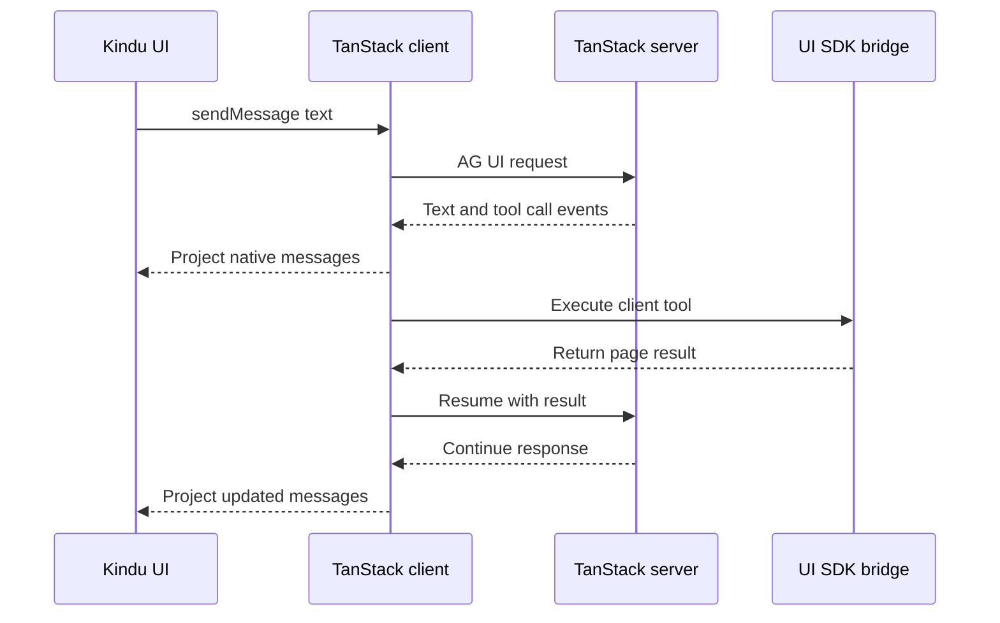

Use TanStack AI as the owner of the conversation and tool execution, Kindu Agent UI as the presentation layer, and UI SDK as a browser tool runtime. Implement a small, pure projection from TanStack messages into Kindu's neutral types, plus a separate bridge from TanStack client tools to UI SDK.

This guide targets a React 19 application using TypeScript and TanStack AI v1. The pure adapter is reusable with other frameworks. API and package checks were performed on 28 November 2026. The included modules compile against the pinned packages and pass eleven focused tests. The React composition example requires the application's installed Kindu registry components; it is not included in that standalone compile check. A live model and full browser flow still need the integration tests below.

# Recommended architecture

The critical discovery is that Kindu's existing AI SDK adapter is a set of conversion functions. It is not a transport, chat store, or provider. Its public functions include `fromUIMessages`, `fromUIMessagePart`, `fromChatStatus`, and `toApprovalResponse`. The latter builds an AI SDK approval argument; it is specific to that SDK. See the [Kindu adapter](https://kindui.dev/docs/agent-ui/adapters/ai-sdk/) and its [published source](https://github.com/kind-ui/agent-ui/tree/6c76f28858acec9b95080080da76acda2d63c5f7/packages/agent-ui/src/adapters/ai-sdk).

Write the TanStack equivalent as a local module such as `src/ai/tanstack-adapter.ts`. The proposed `fromTanStackMessages` and `fromTanStackPart` names in this guide are your own exports. There is no need to invent a Kindu `ChatAdapter` class or `AgentUIProvider` contract, or assume a published `@kind-ui/agent-ui/adapters/tanstack` entry exists.

| Layer | Responsibility | Authoritative state |
| - | - | - |
| TanStack server | Provider calls, server tools, model loop, run protocol | Trusted server configuration and any persisted run state |
| TanStack client | Native messages, stream reduction, client tool scheduling, result submission, interrupts | `useChat` |
| Kindu adapter | Convert native messages into `Message`, `Part`, `Step`, and `Approval` | No independent conversation store |
| Kindu components | Transcript, composer, tool cards, approval controls | Presentation state and local drafts |
| UI SDK bridge | Inspect and change registered application components | The mounted application |



Use native TanStack transport end to end: `fetchServerSentEvents` on the client and `toServerSentEventsResponse` on the server. SSE is the framing; the payload is TanStack's AG-UI event protocol. A Vercel AI SDK stream is a different protocol. A TypeScript cast cannot convert either the wire protocol or the message shapes.

There are two valid adoption paths:

| Situation | Recommended path |
| - | - |
| Building a TanStack application, or migrating both ends | Native TanStack client and server, plus the custom Kindu projection in this guide |
| Keeping an established AI SDK frontend while changing the server | Keep Kindu's existing AI SDK adapter and use the official `@tanstack/ai-vercel-compat` bridge temporarily |

The compatibility package supplies `chatParamsFromAISDKRequest` and `toUIMessageStreamResponse` for the second path. Its feature mapping has limits, so assess the [compatibility table](https://tanstack.com/ai/latest/docs/migration/ai-sdk-compatibility) before selecting it. TanStack documents it as a migration bridge. See [AI SDK client with TanStack server](https://tanstack.com/ai/latest/docs/migration/ai-sdk-client-tanstack-server).

# Establish the package baseline

Inspect the application's manifest, lockfile, framework, and local `AGENTS.md` instructions before changing dependencies. Use the installed declarations as the implementation contract, and pin a mutually compatible set. These are the published versions checked for this reference:

| Package | Checked version |
| - | - |
| `@tanstack/ai` | `1.8.0` |
| `@tanstack/ai-client` | `1.2.1` |
| `@tanstack/ai-react` | `1.1.1` |
| `@tanstack/ai-openai` | `1.2.0` |
| `@kind-ui/agent-ui` | `0.8.0` |
| `@ui-sdk/core` | `0.1.0-beta.17` |
| `@ui-sdk/react` | `0.1.0-beta.17` |

TanStack packages have independent version numbers. Kindu's checked release depends on the listed UI SDK core version. Its installation guidance requires React 19 and Tailwind CSS 4 and recommends pinning the coordinated Kindu/UI SDK packages. Use a single compatible UI SDK core instance so the components and bridge share registration state. The bundle's `package-lock.json` records the entire checked dependency tree.

For a new project, add the Kindu registry to `components.json`:

```json
{
  "registries": {
    "@kind-ui": "https://kindui.dev/r/{name}.json"
  }
}
```

Then install the presentation components into the application:

```sh
npx shadcn@latest add @kind-ui/conversation @kind-ui/message @kind-ui/markdown @kind-ui/composer @kind-ui/tool @kind-ui/reasoning
```

Styled components are copied into the app, typically under `@/components/ui`. Import neutral types from `@kind-ui/agent-ui`; there is no public `@kind-ui/agent-ui/types` entry. Ensure the app stylesheet includes `@import "@kind-ui/agent-ui/styles.css";`. The registry may write caret ranges, so reconcile them with the coordinated versions you selected. See the [published installation guide](https://kindui.dev/docs/agent-ui/).

Suggested application files:

| File | Purpose |
| - | - |
| `src/ai/ui-tool-definitions.ts` | Shared canonical tool descriptions and schemas |
| `src/ai/ui-runtime.ts` | Browser bridge, validation, permissions, ordering |
| `src/ai/ui-tools.ts` | Native TanStack client executors |
| `src/ai/tanstack-adapter.ts` | Pure presentation projection |
| `src/ai/approvals.ts` | Approval projection and current-identity checks |
| Application chat endpoint | Instantiate the server handler with authentication and budgets |
| `src/components/agent-chat.tsx` | Compose the TanStack hook and copied Kindu components |

# Declare UI SDK tools once

UI SDK publishes `act`, `query`, and `snapshot` as `agentTools`, with names, descriptions, and JSON Schemas. Reuse those schemas. Reimplementing their fields by hand creates a second contract that can drift from the bridge. TanStack `toolDefinition` accepts raw JSON Schema; plain schemas infer `unknown`, so the browser dispatch boundary still needs runtime validation.

The UI SDK server guide imports `agentTools` from the React entry. In the checked package that entry has a `"use client"` directive and re-exports the core list. The shared definitions below import that exact list from `@ui-sdk/core/agent`, keeping the module suitable for server graphs. The browser runtime still creates its bridge through `@ui-sdk/react/agent`, matching the rendered components. See [UI SDK server integration](https://ui-sdk.dev/docs/agents/connect-an-agent/run-on-your-server), [core helpers](https://ui-sdk.dev/docs/core/behaviors), and [TanStack tool definitions](https://tanstack.com/ai/latest/docs/reference/functions/toolDefinition).

**ui-tool-definitions.ts**

```ts
import { toolDefinition, type JSONSchema } from "@tanstack/ai";
// The React entry re-exports this list but has a "use client" directive.
import { agentTools } from "@ui-sdk/core/agent";

export type UiToolName = "act" | "query" | "snapshot";

function defineUiTool<Name extends UiToolName>(name: Name) {
  const published = agentTools.find((entry) => entry.name === name);
  if (!published) throw new Error(`UI SDK does not publish the ${name} tool`);
  return toolDefinition({
    name,
    description: published.description,
    // Preserve the published schema object; this assertion is not validation.
    inputSchema: published.inputSchema as JSONSchema,
  });
}

export const uiToolDefinitions = {
  act: defineUiTool("act"),
  query: defineUiTool("query"),
  snapshot: defineUiTool("snapshot"),
};

// Server: advertise definitions only. Browser operations have no server execute.
export const uiServerTools = [
  uiToolDefinitions.act,
  uiToolDefinitions.query,
  uiToolDefinitions.snapshot,
];
```

Pass `uiServerTools` to server `chat()` without a server implementation. Only the browser attaches `.client(...)` executors. Keep the allowed names explicit; never dynamically index an arbitrary model-supplied method name on the bridge. Avoid name collisions with application server tools.

# Execute browser tools through one runtime

The reference runtime validates the original schemas with Ajv2020, creates the UI SDK bridge lazily in the browser, serializes all three operations, and passes TanStack's tool abort signal into `act`.

Serialization is an integration choice: UI SDK already queues asynchronous `act` and `query`, but `snapshot` is synchronous. A common queue prevents a snapshot from observing the middle of another queued operation. Check a queued invocation's captured signal when it actually starts, so a stopped call cannot mutate the page later.

`query` has no documented signal argument. The runtime therefore makes its permission waits observe the active TanStack signal through `allow`. It does not claim to forcibly interrupt an arbitrary already-running component callback. Read the [UI SDK method reference](https://ui-sdk.dev/docs/agents/connect-an-agent/reference).

**ui-runtime.ts**

```ts
import { createAgent } from "@ui-sdk/react/agent";
import { Ajv2020 } from "ajv/dist/2020.js";
import type { JSONSchema } from "@tanstack/ai";
import { uiToolDefinitions, type UiToolName } from "./ui-tool-definitions.js";

// beta.17 publishes no $schema; all its keywords are compatible with 2020-12.
// No coercion/default insertion: validate the published contract unchanged.
const ajv = new Ajv2020({ allErrors: true });
const validators = {
  act: ajv.compile(uiToolDefinitions.act.inputSchema),
  query: ajv.compile(uiToolDefinitions.query.inputSchema),
  snapshot: ajv.compile(uiToolDefinitions.snapshot.inputSchema),
};

export type UiAgent = ReturnType<typeof createAgent>;
export type UiAgentOptions = NonNullable<Parameters<typeof createAgent>[0]>;
export type UiAction = Parameters<NonNullable<UiAgentOptions["allow"]>>[0];
export type UiActInput = Parameters<UiAgent["act"]>[0];
export type UiQueryInput = Parameters<UiAgent["query"]>[0];
export interface UiRuntimeOptions {
  policy(action: UiAction): "allow" | "deny" | "confirm";
  // Close the application-owned prompt when signal aborts. Rejections deny.
  confirm(action: UiAction, context: { signal: AbortSignal }): Promise<boolean>;
  // Optional additional application validation after canonical schema checks.
  validateInput?(name: UiToolName, input: unknown, schema: JSONSchema): void;
}

// Keep one instance per browser application; construction itself is SSR-safe.
export function createUiRuntime(options: UiRuntimeOptions) {
  let bridge: UiAgent | undefined;
  let activeSignal: AbortSignal | undefined;
  let tail: Promise<void> = Promise.resolve();

  function ask(action: UiAction, signal: AbortSignal): Promise<boolean> {
    if (signal.aborted) return Promise.resolve(false);
    return new Promise((resolve) => {
      const finish = (allowed: boolean) => {
        signal.removeEventListener("abort", onAbort);
        resolve(allowed && !signal.aborted);
      };
      const onAbort = () => finish(false);
      signal.addEventListener("abort", onAbort, { once: true });
      Promise.resolve()
        .then(() => signal.aborted ? false : options.confirm(action, { signal }))
        .then(finish, () => finish(false));
    });
  }

  function getBridge(): UiAgent {
    if (typeof window === "undefined") {
      throw new Error("UI SDK bridge operations require a browser");
    }
    return bridge ??= createAgent({
      allow: (action, { signal: bridgeSignal }) => {
        const signal = activeSignal
          ? AbortSignal.any([bridgeSignal, activeSignal])
          : bridgeSignal;
        if (signal.aborted) return false;
        const decision = options.policy(action);
        if (decision !== "allow" && decision !== "confirm") return false;
        // A marked control always requires a person, even if policy allows it.
        return action.confirm !== undefined || decision === "confirm"
          ? ask(action, signal)
          : decision === "allow";
      },
    });
  }

  function run<T>(
    name: UiToolName, input: unknown, signal: AbortSignal | undefined,
    work: (agent: UiAgent) => T | Promise<T>,
  ): Promise<T> {
    const result = tail.then(async () => {
      signal?.throwIfAborted(); // A stopped queued call must never execute.
      const validate = validators[name];
      if (!validate(input)) {
        throw new Error(`Invalid ${name} input: ${ajv.errorsText(validate.errors)}`);
      }
      options.validateInput?.(name, input, uiToolDefinitions[name].inputSchema);
      activeSignal = signal;
      try { return await work(getBridge()); }
      finally { activeSignal = undefined; }
    });
    tail = result.then(() => undefined, () => undefined);
    return result;
  }

  // After validation, bridge unknown JSON to SDK input types. Raw JSON Schema
  // alone does not infer a TypeScript input type.
  return {
    snapshot: (input: unknown, signal?: AbortSignal) =>
      run("snapshot", input, signal, (agent) => agent.snapshot()),
    act: (input: unknown, signal?: AbortSignal) =>
      run("act", input, signal, (agent) => agent.act(input as UiActInput, { signal })),
    query: (input: unknown, signal?: AbortSignal) =>
      run("query", input, signal, (agent) => agent.query(input as UiQueryInput)),
  };
}

export type UiRuntime = ReturnType<typeof createUiRuntime>;
```

The application supplies two concrete functions:

- `policy(action)`: decide whether the resolved business action is allowed, refused, or needs confirmation. Include necessary navigation actions in the policy if the task should reach closed sections.

- `confirm(action, { signal })`: show a person the proposed operation, return their choice, and close the prompt when the signal aborts. The wrapper settles false on cancellation even if the application promise has not settled.

For a small demo, a policy can allow `setValue` on the Region Select and deny other actions. Production authorization belongs in the application and server operations; user-editable labels are not authority. A `data-agent-confirm` mark must still prompt even when ordinary policy would permit the action.

Create one runtime in the client application shell and keep its identity stable. A `useState` initializer is suitable because construction does not touch the DOM; the actual bridge is created on first execution. Keep human confirmation UI outside the agent's actionable surface.

The native TanStack executors are short:

**ui-tools.ts**

```ts
import { clientTools } from "@tanstack/ai-client";
import { uiToolDefinitions } from "./ui-tool-definitions.js";
import type { UiRuntime } from "./ui-runtime.js";

// Use once when composing useChat({ tools }). TanStack records results and
// continues the turn. Do not also execute these calls in a message effect.
export function createUiClientTools(runtime: UiRuntime) {
  return clientTools(
    uiToolDefinitions.act.client((input, context) =>
      runtime.act(input, context?.abortSignal)),
    uiToolDefinitions.query.client((input, context) =>
      runtime.query(input, context?.abortSignal)),
    uiToolDefinitions.snapshot.client((input, context) =>
      runtime.snapshot(input, context?.abortSignal)),
  );
}
```

Returning from a `.client()` executor supplies its result to TanStack. The SDK owns result submission and continuation. Do not also call `addToolResult`, call `reload`, or execute tool parts from a React effect. That would introduce a second owner of execution. TanStack documents this native flow in [Client Tools](https://tanstack.com/ai/latest/docs/tools/client-tools).

UI SDK may return `{ ok: false, steps, values, error }` from a correctly executed `act` call, or an error object from `query`. Return those objects intact. A failure after earlier successful steps is not a rollback. A tool-specific Kindu renderer may label the action as refused or partially applied while retaining the full output. Keep that domain outcome distinct from a transport or executor exception.

# Serve TanStack requests and resumptions

Parse requests with `chatParamsFromRequest`. It understands the current AG-UI request shape. Forward the resulting messages, thread ID, run ID, parent run ID, and resume payload. Browser tool continuation uses another request; dropping its resume fields can prevent the paused call from continuing.

Use server-selected tool definitions and an allowed model. Extra client values arrive in `forwardedProps`; validate them before use. A protocol parser does not authenticate a caller or authorize a thread. The factory below requires a host authorization function, where the application also enforces its budget across continuation requests. See [request options](https://tanstack.com/ai/latest/docs/transports/request-options) and [core API](https://tanstack.com/ai/latest/docs/api/ai).

**server-route.ts**

```ts
import {
  chat,
  chatParamsFromRequest,
  maxIterations,
  toServerSentEventsResponse,
} from "@tanstack/ai";
import { openaiText } from "@tanstack/ai-openai";
import { uiServerTools } from "./ui-tool-definitions.js";

type ParsedRequest = Awaited<ReturnType<typeof chatParamsFromRequest>>;

// The host must authenticate, authorize the thread, and enforce a logical-turn
// budget across resume requests. Returning a Response rejects the request.
export type AuthorizeRun = (
  request: Request,
  params: ParsedRequest,
) => Promise<Response | undefined>;

export function createChatPost(authorizeRun: AuthorizeRun) {
  return async function POST(request: Request): Promise<Response> {
    let params: ParsedRequest;
    try {
      params = await chatParamsFromRequest(request);
    } catch (error) {
      if (error instanceof Response) return error;
      throw error;
    }
    const rejection = await authorizeRun(request, params);
    if (rejection) return rejection;

    const abortController = new AbortController();
    const abort = () => abortController.abort();
    if (request.signal.aborted) abort();
    else request.signal.addEventListener("abort", abort, { once: true });

    async function* responseStream() {
      try {
        yield* chat({
          adapter: openaiText("gpt-4.1"), // Example; choose an allowed server model.
          messages: params.messages,
          threadId: params.threadId,
          runId: params.runId,
          parentRunId: params.parentRunId,
          ...(params.resume ? { resume: params.resume } : {}),
          tools: uiServerTools,
          repairToolInput: false,
          agentLoopStrategy: maxIterations(8), // Per run, not the whole user turn.
          abortController,
        });
      } finally {
        request.signal.removeEventListener("abort", abort);
      }
    }
    return toServerSentEventsResponse(responseStream(), { abortController });
  };
}
```

Mount the result at the application's `/api/chat` endpoint. In a Next.js route module, for example, export `POST = createChatPost(authorizeRun)` after importing the application's real `authorizeRun`. Keep the provider configuration and API credentials on the server. The sample model is an illustrative supported adapter ID, not a model-selection recommendation.

The shared abort controller connects response cancellation to the active server call. The request-abort listener is removed when streaming finishes. This is the ephemeral SSE path. Durable detached runs require an explicit authorized server-cancel mechanism; closing the browser stream alone need not stop a durable run.

`maxIterations(8)` limits one server `chat()` run. A browser tool resume starts another run, so it is not a global user-turn limit. Track a logical turn across parent/resume relationships and cap continuation count, elapsed work, and UI action count as appropriate for the application.

# Implement the Kindu projection

Build on TanStack's public `selectChatUI` from `@tanstack/ai-client/ui`. It correlates calls, results, and approval interrupts using their IDs. Match across the full supplied transcript, preserve an unmatched result, and suppress a matched result's duplicate display. These responsibilities are described in [Custom Chat UI Adapters](https://tanstack.com/ai/latest/docs/ui/custom-adapters).

The adapter API in this reference is intentionally close to Kindu's existing mapper:

```ts
fromTanStackMessages(messages, options?): KinduMessage[]
fromTanStackPart(selectedPart, context): KinduPart | null
fromChatStatus(status): KinduMessageStatus
```

`fromTanStackPart` receives a selected descriptor, not an isolated raw part. A raw tool-call part alone cannot tell you the corresponding result's error or cancellation outcome.

## Message and part conversion

| TanStack value | Kindu value or policy |
| - | - |
| `text.content` | `text.text` |
| Visible `thinking.content` | `reasoning.text` |
| `tool-call` plus matching `tool-result` | One `step` whose `kind` is `tool` |
| `ready` chat state | `complete` message state |
| `submitted`, `streaming`, `error` | Same named message state |
| Tool call ID | Both the part ID and step ID |
| Other part identity | `${messageId}:${originalPartIndex}` |
| `createdAt: Date` | ISO timestamp |
| `activity` role | Explicit display-only system role, with original role in metadata |
| Unmatched results and unimplemented advanced parts | `data` parts for dedicated renderers |
| Redacted thinking | Retained as data, never displayed as readable reasoning |

TanStack text and thinking parts lack Kindu's `state` field. The reference infers streaming only for the final part of the active assistant message. Earlier text and reasoning are done. Treat this as a presentation inference, not a new runtime fact.

## Tool state conversion

| Native condition | Kindu step status | Additional data |
| - | - | - |
| `awaiting-input` | `pending` | Input is streaming |
| `input-streaming` | `running` | Preserve partial argument text |
| `input-complete` | `running` | Parsed input is ready |
| `approval-requested` | `awaiting-input` | Current approval identity |
| `approval-responded` with approval | `running` | Decision retained |
| Successful result or completed output | `complete` | Available output |
| Streaming result | `running` | Preliminary output |
| Failed result | `error` | Error outcome and message |
| Denied result | `cancelled` | Outcome remains `denied` |
| Cancelled result | `cancelled` | Outcome remains `cancelled` |

Result outcomes take precedence over a generic tool-call error state. Preserve `false`, `0`, `""`, and `null`; a truthiness check would erase valid outputs. Prefer `part.input` and `part.output` when available. The fallback parser tolerates incomplete argument JSON and interprets serialized result JSON when valid. Unknown tool states stay data rather than being guessed. See [Tool Architecture](https://tanstack.com/ai/latest/docs/tools/tool-architecture).

**tanstack-adapter.ts**

```ts
import type { ChatClientState, UIMessage } from "@tanstack/ai-client";
import {
  selectChatUI,
  type ChatUIInterrupt,
  type ChatUISelectedPart,
  type ChatUISelectedToolPart,
} from "@tanstack/ai-client/ui";
import type { Approval, Message, MessageStatus, Part, StepStatus, ToolCall } from "@kind-ui/agent-ui";

export interface AdapterOptions {
  status?: ChatClientState;
  error?: { message: string } | null;
  interrupts?: readonly ChatUIInterrupt[];
  /** Host-owned history, e.g. the particular message that was stopped. */
  messageStatus?: Readonly<Record<string, MessageStatus>>;
  messageErrors?: Readonly<Record<string, { message: string }>>;
  /** Optional policy override; live interrupts and historical approval are defaults. */
  approvalForTool?: (selected: ChatUISelectedToolPart) => Approval | undefined;
}

export interface PartContext {
  messageId: string;
  index: number;
  streaming: boolean;
  approvalOverride?: Approval;
}

const chatStatuses: Record<ChatClientState, MessageStatus> = {
  ready: "complete", submitted: "submitted", streaming: "streaming", error: "error",
};
const toolStatuses: Record<ChatUISelectedToolPart["part"]["state"], StepStatus> = {
  "awaiting-input": "pending", "input-streaming": "running", "input-complete": "running",
  "approval-requested": "awaiting-input", "approval-responded": "running",
  complete: "complete", error: "error",
};

export function fromChatStatus(status: ChatClientState = "ready"): MessageStatus {
  return chatStatuses[status];
}

/** Partial JSON is displayable input; never throw while arguments stream. */
function parseIfJSON(value: unknown): unknown {
  if (typeof value !== "string") return value;
  try { return JSON.parse(value); } catch { return value; }
}

function approvalFor(selected: ChatUISelectedToolPart): Approval | undefined {
  const interrupt = selected.interrupt;
  if (interrupt?.kind === "tool-approval") {
    return {
      approvalId: interrupt.id,
      generation: interrupt.generation,
      state: interrupt.status === "pending" ? "requested"
        : interrupt.status === "error" ? "submit-failed" : "submitting",
    };
  }
  const historical = selected.part.approval;
  if (!historical) return undefined;
  return {
    approvalId: historical.id,
    generation: 0, // Only legacy transcript metadata lacks a generation.
    state: historical.approved === undefined ? "requested" : "responded",
    ...(historical.approved !== undefined ? { decision: { approved: historical.approved } } : {}),
  };
}

/** A presentation projection only. Never use this output as model history. */
export function fromTanStackPart(selected: ChatUISelectedPart, ctx: PartContext): Part | null {
  const part = selected.part;
  const id = `${ctx.messageId}:${ctx.index}`;
  if (selected.key === "toolResult" && selected.matched) return null;
  if (part.type === "text") {
    return { type: "text", id, text: part.content, state: ctx.streaming ? "streaming" : "done" };
  }
  if (part.type === "thinking") {
    // Runtime core parts can contain opaque provider artefacts absent from client declarations.
    if ("redacted" in part && part.redacted === true) {
      return { type: "data", id, name: "redacted-thinking", data: part };
    }
    return { type: "reasoning", id, text: part.content, state: ctx.streaming ? "streaming" : "done" };
  }
  if (selected.key !== "toolCall") {
    // Multimodal, activity, structured output, subagents and orphan results need explicit renderers.
    return { type: "data", id, name: part.type, data: part };
  }

  const callPart = selected.part;
  const result = selected.result;
  if (!Object.hasOwn(toolStatuses, callPart.state)
    || (result && !["complete", "streaming", "error"].includes(result.state))) {
    return { type: "data", id: callPart.id, name: "tool-call", data: { call: callPart, result } };
  }
  const approval = ctx.approvalOverride ?? approvalFor(selected);
  const call: ToolCall = {
    toolCallId: callPart.id,
    name: callPart.name,
    dynamic: false, // TanStack has no corresponding dynamic/static discriminator.
    input: {
      state: callPart.state === "awaiting-input" || callPart.state === "input-streaming" ? "streaming" : "ready",
      value: callPart.input !== undefined ? callPart.input : parseIfJSON(callPart.arguments),
    },
    ...(approval ? { approval } : {}),
  };
  let status = toolStatuses[callPart.state];
  let error: { message: string; detail?: unknown } | undefined;
  if (result?.outcome === "cancelled" || result?.outcome === "denied") {
    call.outcome = result.outcome;
    status = "cancelled";
  } else if (approval?.decision?.approved === false) {
    call.outcome = "denied";
    status = "cancelled";
  } else if (result?.state === "error" || callPart.state === "error") {
    call.outcome = "error";
    status = "error";
    error = { message: result?.error ?? "Tool execution failed.", detail: result?.content };
  } else if (result || callPart.output !== undefined) {
    const preliminary = result?.state === "streaming";
    status = preliminary ? "running" : "complete";
    call.output = {
      state: preliminary ? "preliminary" : "available",
      value: callPart.output !== undefined ? callPart.output : parseIfJSON(result?.content),
    };
  } else if (approval && callPart.state !== "complete") {
    status = approval.state === "responded" || approval.state === "auto" ? "running" : "awaiting-input";
  }
  return {
    type: "step", id: callPart.id,
    step: { id: callPart.id, kind: "tool", title: callPart.name, status, call, ...(error ? { error } : {}) },
  };
}

function isoDate(value: unknown): string | undefined {
  if (!(value instanceof Date) && typeof value !== "string") return undefined;
  const date = value instanceof Date ? value : new Date(value);
  return Number.isNaN(date.getTime()) ? undefined : date.toISOString();
}

export function fromTanStackMessages(
  messages: readonly UIMessage[],
  options: AdapterOptions = {},
): Message[] {
  // This selector joins tool results by call ID across the entire transcript.
  const selected = selectChatUI({ messages, interrupts: options.interrupts });
  return selected.messages.map(({ message, parts }, messageIndex) => {
    const last = messageIndex === messages.length - 1;
    const status = options.messageStatus?.[message.id] ?? (last ? fromChatStatus(options.status) : "complete");
    const error = options.messageErrors?.[message.id] ?? (last ? options.error : undefined);
    const createdAt = isoDate(message.createdAt);
    const projected: Message = {
      id: message.id,
      // Kindu has no activity role. This projection stays strictly on the display side.
      role: message.role === "activity" ? "system" : message.role,
      status,
      parts: parts.flatMap((part, index) => fromTanStackPart(part, {
        messageId: message.id, index,
        // TanStack has no text-part state; infer only the current trailing part.
        streaming: status === "streaming" && message.role === "assistant" && index === parts.length - 1,
        approvalOverride: part.key === "toolCall" ? options.approvalForTool?.(part) : undefined,
      }) ?? []),
      ...(createdAt ? { createdAt } : {}),
      ...(error ? { error: { message: error.message } } : {}),
    };
    if (message.metadata || message.role === "activity") {
      projected.metadata = {
        ...message.metadata,
        ...(message.role === "activity" ? { originalRole: "activity" } : {}),
      };
    }
    return projected;
  });
}
```

This is a rendering projection. Persist and send TanStack's native messages, including provider metadata and interrupt/resume state. Kindu messages do not contain every native field and cannot be converted back losslessly. Never pass the mapped result into `chat.setMessages` or the server request.

The optional per-message status/error overlays retain presentation history such as a previously aborted answer. TanStack's current global status returns to ready after Stop, so a stateless status conversion cannot infer that history. Store overlays by stable message ID, independently from canonical messages, and clear affected entries on an explicitly authorized retry.

# Wire approvals to current TanStack interrupts

There are two approval layers with different scopes:

| Approval | Scope | Resolution |
| - | - | - |
| TanStack tool approval | Whether the entire tool invocation may execute | The current interrupt's `resolveInterrupt` |
| UI SDK `allow` | Whether a resolved component action may run | Return the person's or policy's boolean decision |

For the baseline UI tools, let UI SDK enforce per-action policy. Add `needsApproval: true` to a shared TanStack tool definition only when the product also needs approval of the whole call. If both layers are enabled, design the UX for both; approving a batch does not bypass component permissions.

Use live interrupt IDs and generations. Kindu's generation field can map directly to TanStack's current generation; do not hard-code zero for live requests. The reference's historical fallback uses zero only because old transcript approval metadata lacks that field. A historical card alone is never authority to execute.

**approvals.ts**

```ts
import type { Approval } from "@kind-ui/agent-ui";
import type { ChatUIInterrupt } from "@tanstack/ai-client/ui";

export function approvalView(interrupt: ChatUIInterrupt): Approval | undefined {
  if (interrupt.kind !== "tool-approval") return undefined;
  return {
    approvalId: interrupt.id,
    generation: interrupt.generation,
    state: interrupt.status === "error"
      ? "submit-failed"
      : interrupt.status === "pending" ? "requested" : "submitting",
  };
}

// Baseline for tools with no approvalSchema. Schema-bearing tools require a
// typed branch that supplies their approval payload as well as the boolean.
export function resolveToolApproval(
  interrupts: readonly ChatUIInterrupt[],
  toolCallId: string,
  event: Pick<Approval, "approvalId" | "generation">,
  approved: boolean,
  resuming: boolean,
): void {
  const current = interrupts.find((item) =>
    item.kind === "tool-approval" && item.toolCallId === toolCallId &&
    item.id === event.approvalId && item.generation === event.generation,
  );
  if (!current || current.kind !== "tool-approval" ||
      !current.canResolve || resuming ||
      (current.status !== "pending" && current.status !== "error")) {
    throw new Error("This approval is no longer available. Refresh its state.");
  }
  current.resolveInterrupt(approved);
}
```

Read the latest chat state inside the callback before calling `resolveToolApproval`. A React closure from an old render can otherwise validate an event against an old interrupt array. The React example below uses a ref for this purpose.

There is no generic TanStack equivalent of AI SDK's `toApprovalResponse` object. Resolve the native bound interrupt so its binding and continuation machinery remain intact. For a reason-bearing rejection, define an `approvalSchema` and use its typed `resolveInterrupt(false, { payload: { reason } })` branch. The boolean-only helper above is for tools without an approval payload schema. See [Tool Approval](https://tanstack.com/ai/latest/docs/interrupts/tool-approval).

Display generic and unbound interrupts separately. If you use `selectChatUI` to place approvals inline, its residual interrupt list is useful for requests without a visible corresponding call. An unbound interrupt belongs to another owner and must not be automatically resolved as a tool approval.

# Compose the React interface

Use TanStack `useChat` directly. Keep the connection, client tools, and browser runtime stable. Supply a stable thread ID. Mount the chat with `key={threadId}` when switching conversations, and stop the old page-bound UI work before the new conversation can act on the same application.

The following example uses components copied by the Kindu registry. It includes an explicit Stop control outside Composer because a later approval/resume can outlive the original composer submission promise. It guards busy submissions and rejects unsupported attachments so a pasted file is not silently discarded. The example is in `chat-composition.tsx.example`; adapt and type-check it inside the host after installing those local components.

**chat-composition.tsx.example**

```tsx
"use client";

import { useEffect, useMemo, useRef, useState } from "react";
import { fetchServerSentEvents, useChat } from "@tanstack/ai-react";
import type { ChatUIInterrupt } from "@tanstack/ai-client/ui";
import type { MessageStatus, Part } from "@kind-ui/agent-ui";
import { fromTanStackMessages } from "./tanstack-adapter.js";
import { resolveToolApproval } from "./approvals.js";
import { createUiClientTools } from "./ui-tools.js";
import type { UiRuntime } from "./ui-runtime.js";
import { Composer, ComposerInput, ComposerStop, ComposerSubmit } from "@/components/ui/composer";
import { Conversation, ConversationContent, ConversationJump, ConversationRow, ConversationViewport } from "@/components/ui/conversation";
import { Message, MessageContent, MessageOutcome } from "@/components/ui/message";
import { Markdown } from "@/components/ui/markdown";
import { Reasoning } from "@/components/ui/reasoning";
import { Tool } from "@/components/ui/tool";

// Mount with key={threadId} when switching conversations. The application shell
// owns a stable runtime configured with its policy and human confirmation UI.
export function AgentChat({ threadId, runtime }: { threadId: string; runtime: UiRuntime }) {
  const connection = useMemo(() => fetchServerSentEvents("/api/chat"), []);
  const tools = useMemo(() => createUiClientTools(runtime), [runtime]);
  const chat = useChat({ threadId, connection, tools, queue: "drop" });
  // The baseline client tools need no whole-tool approval. Widen the display
  // view so it can also render approval-enabled tools added by the host.
  const interrupts: readonly ChatUIInterrupt[] = chat.interrupts;
  const latestChat = useRef(chat);
  latestChat.current = chat;
  const sending = useRef(false);
  const [submitError, setSubmitError] = useState<string>();
  // This page-bound example stops its UI work when the view goes away.
  useEffect(() => () => latestChat.current.stop(), []);
  const [messageStatus, setMessageStatus] = useState<Record<string, MessageStatus>>({});
  const rendered = fromTanStackMessages(chat.messages, {
    status: chat.status, error: chat.error, interrupts: chat.interrupts, messageStatus,
  });
  const stop = () => {
    const live = latestChat.current;
    const current = live.messages.at(-1);
    if (current && (live.status === "submitted" || live.status === "streaming" || live.resuming || live.interrupts.length > 0)) {
      setMessageStatus((old) => ({ ...old, [current.id]: "aborted" }));
    }
    live.stop();
  };

  function renderPart(part: Part) {
    if (part.type === "text") return <Markdown key={part.id} source={part.text} streaming={part.state === "streaming"} />;
    if (part.type === "reasoning") return <Reasoning key={part.id} text={part.text} status={part.state === "streaming" ? "running" : "complete"} />;
    if (part.type === "step" && part.step.kind === "tool") {
      const { call, status, error } = part.step;
      const live = interrupts.find((item) => item.kind === "tool-approval" && item.toolCallId === call.toolCallId);
      const canRespond = live?.canResolve && !chat.resuming && (live.status === "pending" || live.status === "error");
      return <Tool key={part.id} call={call} status={status} error={error}
        onApprove={canRespond ? async (event) => {
          const current = latestChat.current;
          resolveToolApproval(current.interrupts, call.toolCallId, event, true, current.resuming);
        } : undefined}
        onDeny={canRespond ? async (event) => {
          const current = latestChat.current;
          resolveToolApproval(current.interrupts, call.toolCallId, event, false, current.resuming);
        } : undefined}
      />;
    }
    if (part.type === "data" && part.name === "redacted-thinking") return null;
    // Replace with a type-specific renderer before enabling advanced content.
    return <p key={part.id}>Additional {part.type} content is available.</p>;
  }

  return (
    <section data-agent-hidden className="flex h-full flex-col gap-4">
      <Conversation aria-label="Assistant" messageCount={rendered.length} className="min-h-0 flex-1">
        <ConversationViewport><ConversationContent>
          {rendered.map((message, index) => (
            <ConversationRow key={message.id} value={message.id} index={index}>
              <Message messageRole={message.role} status={message.status} error={message.error?.message}>
                <MessageContent>{message.parts.map(renderPart)}</MessageContent>
                <MessageOutcome />
              </Message>
            </ConversationRow>
          ))}
        </ConversationContent></ConversationViewport>
        <ConversationJump />
      </Conversation>
      {chat.error && <p role="alert">{chat.error.message}</p>}
      {submitError && <p role="alert">{submitError}</p>}
      {chat.interruptErrors.length > 0 && <p role="alert">An approval could not be submitted. Review the pending request.</p>}
      {interrupts.filter((i) => i.kind !== "tool-approval").map((i) => (
        <p key={i.id}>Paused: {i.reason}. This interrupt needs its application-specific form.</p>
      ))}
      <Composer aria-label="Message" onSubmit={async (draft) => {
        const live = latestChat.current;
        const reject = (message: string): never => {
          setSubmitError(message);
          throw new Error(message); // Preserve the composer draft.
        };
        if (draft.attachments.length > 0) reject("Attachments are not enabled in this example.");
        if (sending.current || live.isLoading || live.resuming || live.interrupts.length > 0) {
          reject("Wait for the current task, resolve its request, or stop it before sending.");
        }
        sending.current = true;
        setSubmitError(undefined);
        try { await live.sendMessage(draft.text); }
        catch (error) {
          setSubmitError(error instanceof Error ? error.message : String(error));
          throw error;
        } finally { sending.current = false; }
      }} onStop={stop}>
        <ComposerInput aria-label="Prompt" placeholder="Ask about this page" />
        <ComposerSubmit />
        <ComposerStop />
      </Composer>
      {/* Also available during separately resumed work or an approval pause. */}
      <button type="button" onClick={stop}>Stop current task</button>
    </section>
  );
}
```

Wrap the chat and permission controls in `data-agent-hidden`. Apply it separately to portalled confirmation content, whose DOM ancestry may differ. The attribute excludes the region from UI SDK inspection and action targeting. `data-agent-secret` only redacts values and is not an exclusion boundary. See [UI SDK Permissions](https://ui-sdk.dev/docs/agents/connect-an-agent/permissions).

The example's basic UI intentionally omits automatic retry actions. TanStack `reload()` replays the latest user request and can cause new UI changes. Add retry only after defining its side-effect policy. A retry button on an older message must not silently replay a different, latest exchange.

The standalone test suite covers the modules, not these copied JSX components or a live browser. Add the host's build and browser tests before treating this composition as production integration.

# Handle lifecycle and richer content

## Stop and navigation

Pass the TanStack executor's `context.abortSignal` through to the runtime. This signal belongs to the client execution lifecycle and survives individual HTTP continuation boundaries. Do not create a fresh independent turn controller for each resume request. TanStack ignores late results from a stopped continuation; the runtime also checks queued work before it starts.

Stop should close pending human prompts, refuse queued mutations, stop the local response, and record the appropriate aborted message status. It cannot undo an action already applied or an arbitrary server operation triggered by a component. Test stopping while waiting for confirmation, during streaming, and during a resumed run. See [client API](https://tanstack.com/ai/latest/docs/api/ai-client).

The reference chooses to stop on chat unmount. A product that keeps tasks alive while a panel is hidden needs explicit lifecycle ownership and an available approval/Stop surface. Multiple browser tabs must not independently execute the same mutation-bearing client call.

## Persistence and recovery

Persist native TanStack history and the appropriate native resume state. Reproject for Kindu on load. Keep page state and conversation state separate: UI SDK refs identify mounted components, and a rebuilt page can invalidate previous assumptions. Refresh the observed UI after remounts, reorderings, and meaningful navigation. Recovery should not automatically replay a UI mutation merely because it appears in restored history.

If external business operations need exactly-once effects, enforce idempotency at that business API. A stable `toolCallId` is valuable correlation, but a UI mapper is not a transaction coordinator.

## Optional observations and undo

UI SDK `agent.subscribe` can collect user/application changes between turns. Filter bridge-originated changes when appropriate, cap the batch, and include observations as data rather than trusted instructions. A controlled component's event can report a requested change before the owner accepts it. Confirm outcomes using actual state or business results. Call the returned unsubscribe function when finished. See [Observe Changes](https://ui-sdk.dev/docs/agents/connect-an-agent/observe-changes).

If the product offers Undo, integrate it explicitly. UI SDK history can restore component values, but it does not reverse saves, network requests, or removed components. Removing a chat message is not undoing its actions. See [History and Undo](https://ui-sdk.dev/docs/agents/connect-an-agent/history-and-undo).

## Advanced part extensions

The adapter preserves advanced native parts as data so they can be implemented deliberately:

| Feature | Implementation task |
| - | - |
| Images and files | Map native `source.type === "url"` using `source.value`, MIME type, and a suitable display name into Kindu file parts. Apply an allowed URL policy. |
| Base64 data sources | Construct a typed data URL only for supported renderable MIME types and bounded sizes. Preserve opaque provider file handles as handles. |
| Composer attachments | Upload/validate the files, create native TanStack content parts, and send `{ content: [...] }`. Upload failure must preserve the draft. |
| Sources | Convert actual source/citation data into Kindu source records with stable IDs. Do not assume AI SDK's `source-url` shape exists in TanStack messages. |
| Structured output | Keep the validated data and add the intended table/card renderer. |
| Subagents | Map their native state into Kindu subagent steps; keep child-run identity. |
| Activity messages | Decide whether to display them in the transcript or a separate activity area; the reference's system role is presentation-only. |
| UI resources | Use an explicit trusted renderer and the appropriate isolation boundary. Do not execute unknown payloads as HTML. |

The underlying source field is `value`, not `url`. Consult [Multimodal Content](https://tanstack.com/ai/latest/docs/advanced/multimodal-content) and the installed content-part declarations. Do not advertise attachment or advanced-content support merely because the fallback preserves its data.

# Implementation sequence for the coding agent

1. Inventory installed versions and local instructions. Verify that TanStack's request parser, `selectChatUI`, `.client()` context, and interrupt methods match this baseline. Record any compatibility changes.

2. Install or refresh the coordinated Kindu/UI SDK components and dependency versions. Confirm one compatible UI SDK core instance.

3. Add the pure mapper and fixture tests first. Require stable IDs, correct result correlation, unknown-part preservation, and no canonical-history mutation.

4. Wire native streaming text from the server to TanStack `useChat`, then project it into Kindu. Verify the native stream without browser tools before introducing page mutations.

5. Add shared UI tool definitions and the browser runtime. Start with snapshot/query and one harmless business field mutation. Confirm a browser result causes exactly one continuation and is visible to the model.

6. Implement the real application policy and abortable human confirmation. Exclude assistant controls. Test an allowed action, a refused action, a marked action, and Stop during the prompt.

7. Add tool-level TanStack approvals if required. Resolve the latest bound interrupt by ID and generation. Test denial, submission failure, replacement, and stale clicks.

8. Complete lifecycle and persistence behavior for the product. Define replay, retry, navigation, multiple-tab ownership, and turn budgets.

9. Add only the advanced renderers the product needs, with appropriate upload and rendering tests. Keep unsupported features explicitly unavailable.

10. Run the host's type checker, build, and browser tests. Document the final package matrix and host-specific integration choices.

## Acceptance matrix

| Scenario | Required result |
| - | - |
| Stream text | Incremental visible output with stable row/part identities |
| Visible reasoning then text | Completed reasoning is not still marked streaming |
| Partial JSON tool arguments | Safe display; no render-time exception |
| Separate call/result, including different messages | One tool card with the matching result |
| Unmatched result | Preserved and handled by a fallback renderer |
| Outputs `false`, `0`, `""`, `null` | Retained as present output |
| Unknown part/state | Preserved data, no guessed completion |
| `act` changes Region | Same registered application control updates and native output reaches the model |
| Action refusal or partial failure | Earlier effects reported accurately; full result retained |
| Tool approval deny | Tool does not execute; denial reaches model |
| Stale approval generation | Current request remains unanswered |
| Stop during UI SDK confirmation | Prompt closes, later steps do not run, no late continuation |
| Stop during separate resumed response | Stop remains reachable and works |
| Multiple tool calls | Browser operations obey the integration queue and results keep correct IDs |
| Thread switch or unmount | Prior page-bound mutations cannot continue into the new conversation |
| Refresh with pending mutation | Recovery follows explicit policy; no automatic replay |
| Chat controls in snapshot/query | Excluded, including portalled approval controls |
| Unsupported pasted attachment | Draft retained with a clear error |
| Send during a pending interruption | No silently discarded draft |
| Long chain of browser continuations | Logical-turn budget applies across runs |

Use a deterministic fake model or controlled event fixture for the integration cases. Real-provider testing should confirm one complete path after the deterministic cases pass; it should not be the only proof of correctness.

## Handoff prompt

Implement the integration described in this guide in the current repository. First inspect the installed versions, framework, and local instructions. Keep TanStack `useChat` authoritative. Add the pure Kindu mapper, canonical UI SDK tool definitions, browser client tools, a server route that forwards resume context, current-generation approval handling, and an abortable UI permission flow. Keep the copied Kindu components and backend message model intact. Treat application authentication, business authorization, confirmation UI, and logical-turn budgets as explicit integration points. Run the acceptance matrix and report exactly which cases were exercised. Do not claim advanced media support or a completed live integration without their corresponding tests.

# Validation and references

The reference TypeScript modules passed strict type checking, with upstream declaration checking skipped. Eleven Node tests passed. They cover cross-message result matching, non-mutation, falsy outputs, partial arguments, error/denial/cancellation precedence, preliminary results, completed approvals, unknown parts/states, streaming/status history, redacted/activity metadata policies, approval generation checks, and validation/cancellation before browser dispatch. No provider was called. The React composition and real browser action/confirmation flows require host integration testing.

Primary references:

- [TanStack AI](https://tanstack.com/ai)

- [TanStack React API](https://tanstack.com/ai/latest/docs/api/ai-react)

- [TanStack client API](https://tanstack.com/ai/latest/docs/api/ai-client)

- [Custom Chat UI Adapters](https://tanstack.com/ai/latest/docs/ui/custom-adapters)

- [Client Tools](https://tanstack.com/ai/latest/docs/tools/client-tools)

- [Tool Architecture](https://tanstack.com/ai/latest/docs/tools/tool-architecture)

- [Tool Approval](https://tanstack.com/ai/latest/docs/interrupts/tool-approval)

- [Server Tools Advanced](https://tanstack.com/ai/latest/docs/tools/server-tools-advanced)

- [AI SDK bridge compatibility](https://tanstack.com/ai/latest/docs/migration/ai-sdk-compatibility)

- [UI SDK server integration](https://ui-sdk.dev/docs/agents/connect-an-agent/run-on-your-server)

- [UI SDK bridge reference](https://ui-sdk.dev/docs/agents/connect-an-agent/reference)

- [UI SDK permissions](https://ui-sdk.dev/docs/agents/connect-an-agent/permissions)

- [Kindu AI SDK adapter](https://kindui.dev/docs/agent-ui/adapters/ai-sdk/)

- [Kindu React chat guide](https://kindui.dev/docs/agent-ui/guides/ai-sdk-chat/)

- [Kindu published source revision](https://github.com/kind-ui/agent-ui/tree/6c76f28858acec9b95080080da76acda2d63c5f7)

Package manifests and declarations were inspected from the published npm artifacts. The bundle pins those versions so the coding agent can repeat the reference checks before adapting the modules to the host application.
